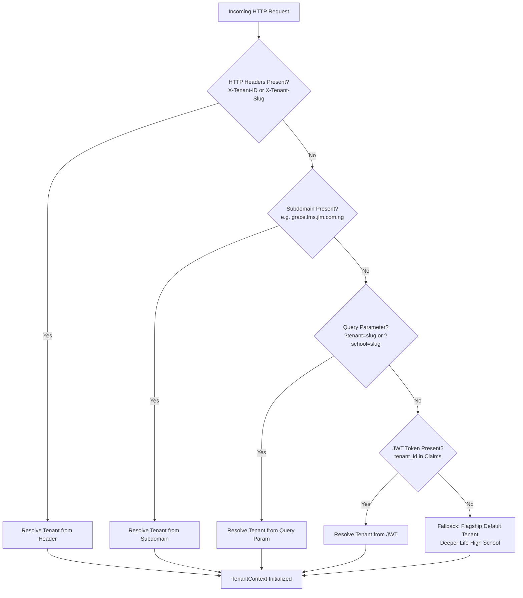

# JLM Results & Academic Management System (LMS)
## Multi-Tenant SaaS Architecture & Decoupling Guide

---

## 1. Executive Summary

The **John Luka Media (JLM) Results Management System** (formerly single-tenant for *Deeper Life High School - Kaduna Campus*) has been refactored into an enterprise-grade, **multi-tenant white-label SaaS platform**.

This enables John Luka Media to license and deploy the school results, broadsheet computation, cumulative 3-term analytics, CBT examination, and electronic transcript verification platform to any number of secondary or tertiary institutions across Nigeria and Africa with **zero cross-tenant data leakage** and **independent institutional branding**.

---

## 2. Tenant Resolution Engine

Tenant resolution is executed in [`api/lib/TenantContext.php`](file:///Applications/MAMP/htdocs/lms/api/lib/TenantContext.php) on every incoming HTTP request using the following deterministic cascade:



### Hierarchy Details:
1. **HTTP Headers:** `X-Tenant-ID` (numeric) or `X-Tenant-Slug` / `X-School-Slug` (string).
2. **Subdomain Routing:** Detects custom or platform subdomains (e.g. `grace.lms.jlm.com.ng` maps to `grace-academy`).
3. **Query Parameter:** `?tenant=<slug>` or `?school=<slug>` (ideal for webhooks, print previews, and testing).
4. **Authenticated JWT:** User's token claim `tenant_id`.
5. **Default Fallback:** `tenants.is_default = 1` (DLHS Kaduna Campus).

---

## 3. Database Schema & Data Isolation

### 3.1 The `tenants` Table

| Column | Type | Description |
| :--- | :--- | :--- |
| `id` | `INT AUTO_INCREMENT PRIMARY KEY` | Internal relational identifier |
| `uuid` | `VARCHAR(64) UNIQUE` | Public secure UUID (e.g. `ten_grace_academy_02`) |
| `name` | `VARCHAR(255)` | Full school name (e.g. `Grace International Academy`) |
| `slug` | `VARCHAR(100) UNIQUE` | URL-safe slug (e.g. `grace-academy`) |
| `acronym` | `VARCHAR(20)` | Official acronym for admission numbers (e.g. `GIA`) |
| `subdomain` | `VARCHAR(100) UNIQUE` | Assigned subdomain |
| `campus` | `VARCHAR(100)` | Campus name (e.g. `Abuja Campus`) |
| `motto` | `VARCHAR(255)` | School motto |
| `vision` | `TEXT` | Institutional vision statement |
| `address` | `TEXT` | Physical address |
| `email` | `VARCHAR(150)` | School contact & admissions email |
| `phone` | `VARCHAR(50)` | Official phone line |
| `principal_name` | `VARCHAR(150)` | Principal / Head of School name |
| `director_name` | `VARCHAR(150)` | Chairman / Director name |
| `logo_url` | `VARCHAR(255)` | Relative or absolute path to institutional logo |
| `theme_primary` | `VARCHAR(20)` | Primary hex color (default: `#023047`) |
| `theme_secondary` | `VARCHAR(20)` | Secondary hex color (default: `#219ebc`) |
| `theme_accent` | `VARCHAR(20)` | Accent hex color (default: `#ffb703`) |
| `status` | `ENUM('active','suspended','trial')` | Account status |
| `subscription_tier` | `ENUM('starter','standard','enterprise')` | SaaS tier |
| `is_default` | `TINYINT(1)` | Whether this is the system fallback tenant |

### 3.2 Tenant Scoping Across Tables

All operational tables have been updated with indexed `tenant_id` foreign keys:
- `users.tenant_id`
- `classes.tenant_id`
- `courses.tenant_id`
- `student_assessments.tenant_id`
- `grades.tenant_id`
- `admissions.tenant_id`
- `student_registrations.tenant_id`
- `fees.tenant_id`
- `fee_payments.tenant_id`
- `exams.tenant_id`
- `attendance.tenant_id`
- `system_settings.tenant_id`
- `messages.tenant_id`
- `materials.tenant_id`

> [!NOTE]
> All 40,302 historical grades, 428 students, and existing school data have been automatically preserved and mapped to Tenant 1 (`dlhs-kaduna`).

---

## 4. Multi-Tenant REST API Endpoints

The API is exposed under `/api` and supports full institutional lifecycle management:

### 4.1 Public & Client Endpoints

#### 1. List Available Institutions
```http
GET /api/tenants
```
Returns a list of all active schools for login portals, applicant selection, and subdomain routing.

#### 2. Get Active Institution Profile
```http
GET /api/tenants/current
Headers:
  X-Tenant-Slug: grace-academy
```
Returns the active school's branding, color palette, motto, address, and administration metadata.

---

### 4.2 Super-Admin Management Endpoints

#### 3. Onboard a New School (SaaS Provisioning)
```http
POST /api/admin/tenants/create
Authorization: Bearer <super_admin_jwt>
Content-Type: application/json

{
  "name": "Kingsway College",
  "slug": "kingsway",
  "acronym": "KC",
  "subdomain": "kingsway",
  "campus": "Lekki Campus",
  "motto": "Strive for the Highest Peak",
  "address": "12 Admiralty Way, Lekki Phase 1, Lagos",
  "email": "info@kingswaycollege.edu.ng",
  "phone": "07011223344",
  "principal_name": "Mrs. Folashade Adeleke",
  "theme_primary": "#0F766E",
  "theme_secondary": "#134E4A",
  "theme_accent": "#F59E0B",
  "admin_email": "principal@kingswaycollege.edu.ng",
  "admin_password": "SecurePassword2026!"
}
```

#### 4. Update Institution Profile & Branding
```http
POST /api/admin/tenants/update
Authorization: Bearer <admin_jwt>
Content-Type: application/json

{
  "id": 2,
  "motto": "Knowledge, Character, and Global Impact",
  "phone": "08099887766"
}
```

#### 5. Institutional Usage Statistics
```http
GET /api/admin/tenants/stats
Authorization: Bearer <admin_jwt>
```
Returns student count, active educators, classes, and broadsheet assessment volume for the active tenant.

---

## 5. Dynamic Report Cards & Electronic Verification

All printable outputs now render dynamic SVG security seals and watermarks based on the resolved tenant:
- **Terminal Report Cards (`/api/reports/print`):** Automatically renders the school header, crest, motto, and principal signature block.
- **Mid-Term Assessment Sheets (`/api/reports/midterm`):** The circular SVG official verification stamp dynamically curves the school name and campus along `<textPath>` vectors:
  ```html
  <textPath href="#stampCircleTop"><?= strtoupper(htmlspecialchars($schoolName)) ?></textPath>
  <textPath href="#stampCircleBottom">★ <?= strtoupper(htmlspecialchars($schoolCampus)) ?> ★</textPath>
  ```
- **Official Academic Transcripts (`/api/reports/transcript`):** Watermarks and tamper-evident security declarations display the issuing school's registered legal identity.
- **Electronic Verification Service (`/api/transcript/verify`):** Public validation portal certifies authenticity against the issuing tenant registry.
